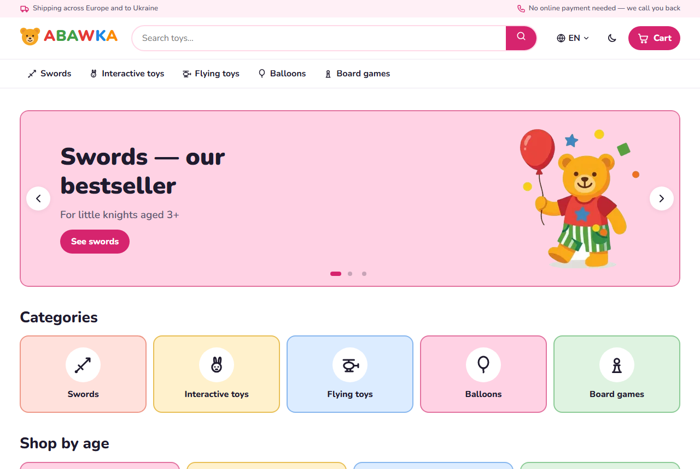
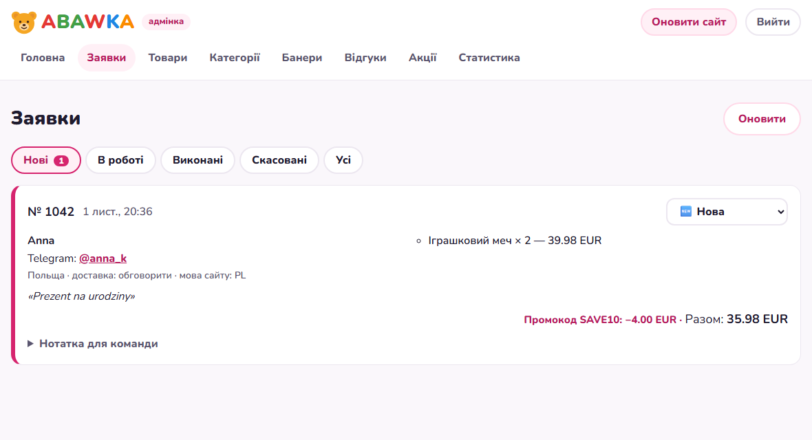
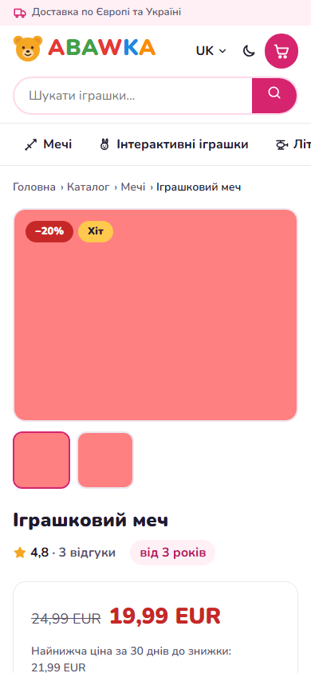
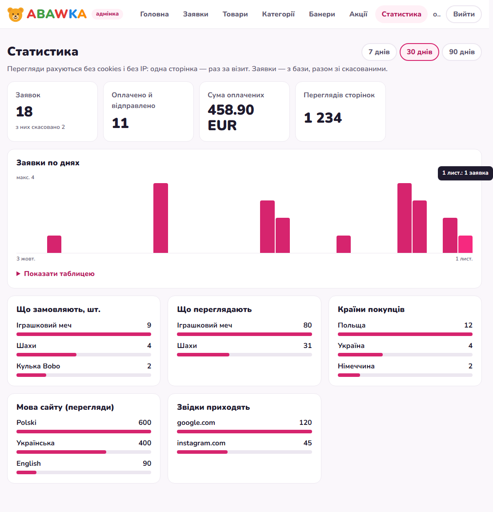

# ABAWKA — multilingual toy shop with Telegram order requests

An online toy shop for customers across Europe and Ukraine: 9 languages, 4 currencies, no card checkout — the buyer sends a request from the cart and the owner gets it in Telegram within seconds, then arranges payment and delivery personally. The owner runs everything from a simple admin panel: products, photos, promotions, reviews, statistics.



## Problem

A small seller ships toys from Poland to all of Europe and Ukraine. Customers speak different languages and think in different currencies, but the seller does not want online card payments or monthly fees for a big e-commerce platform: every order is agreed personally. Off-the-shelf shops force a checkout flow that does not fit, and the seller has to be able to update the catalogue without a developer.

## Solution

- **Static, fast storefront** (Astro): 219 pages in 9 languages (PL, EN, UK, DE, CS, LT, ES, FR, RU) with hreflang, sitemap, per-language 404 pages, dark theme, mobile-first layout.
- **Request instead of checkout:** cart → request form → a Postgres function validates every field again, takes prices and stock from the database (never from the browser), applies the promo code and reserves stock in one transaction. A database trigger signals a Supabase Edge Function that sends the request to the owner's Telegram.
- **Admin panel without code:** products with photo upload (resized in the browser to WebP), one-click translation of descriptions into 8 languages (DeepL), categories, homepage banners, request statuses, promotions, promo codes, review moderation, statistics, and an "Update site" button that rebuilds the site on Netlify.
- **Roles enforced by the database:** owner and manager, with Row Level Security on every table — the browser only holds a public key.
- **EU rules built in:** the lowest price of the last 30 days is shown next to every discount (Omnibus directive), legal pages in all languages, personal data deleted automatically after the periods stated in the privacy policy, statistics counted without cookies or IP addresses.
- **Currencies:** prices in EUR, approximate PLN/USD/UAH at daily ECB and NBU rates.
- **Reviews without accounts:** form → moderation in the admin → published; spam protection with a honeypot and rate limits.

| Order request in Telegram & admin | Product page (mobile) |
|---|---|
|  |  |



*Screenshots use test data.*

## How it is built

```
Browser ──► Netlify (static Astro site)
   │  request / review / promo check
   ▼
Supabase Postgres ── RLS, submit_request(), submit_review(), check_promo()
   │  trigger (pg_net)                       │  pg_cron: daily rates, data cleanup
   ▼                                         ▼
Edge Function telegram ──► Telegram Bot     Edge Function rates ──► ECB / NBU
Admin ──► Edge Functions translate (DeepL), publish (Netlify build hook)
```

## Quality

- **137 end-to-end tests** (Playwright) on a hermetic build: test data, a fake Supabase address and mocked API, so tests never touch the real database, Telegram or email. Layout is checked at 320–1600 px in all 9 languages, plus HTML validation.
- **30 database tests** on real Postgres in Node (PGlite): migrations, RLS for buyer / manager / owner, server-side prices, stock reservation, promo limits, rate limits, data retention.
- Every bug found got a regression test; key tests were verified by breaking the code on purpose.
- Secrets live only in `.env` and Supabase secrets; a pre-commit hook blocks any of them from being committed.

## Result

Built and tested end to end; launching on the client's domain. The owner can run the shop alone: add products from a phone, get requests in Telegram, launch a sale in two clicks.

## Tech stack

Astro 7 · TypeScript · Supabase (Postgres, RLS, Auth, Storage, Edge Functions, pg_cron, pg_net) · Telegram Bot API · DeepL API · Netlify · Playwright · PGlite

## Run it

```bash
cp .env.example .env      # Supabase keys and others — see comments in the file
npm install
npm run dev               # http://localhost:4321
npm run test:e2e          # end-to-end tests (own build on port 4390)
npm run test:db           # database tests in Node, no Docker
```

Database migrations: `npm run db:push`. Edge Functions: `npm run fn:deploy -- <name>`. Deployment settings: `netlify.toml`.

---
Built by Roman Blyshyn — AI automation & Python / TypeScript developer. Available on Upwork.
